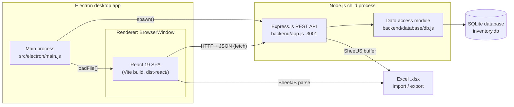

# Architecture — Stock Inventory Management System

A full-stack **desktop application** for inventory management, recipe costing, and menu pricing in a small food-service business. Built with **Electron**, **React 19**, **Node.js**, **Express.js**, and **SQLite**, it exposes a **RESTful API** consumed by a **single-page application (SPA)** frontend.

**Tech stack:** JavaScript (ES Modules) · React · Vite · Electron · Node.js · Express.js · SQLite · SQL · REST API · JSON · Material UI (MUI) · Emotion · Chart.js · SheetJS (xlsx) · Jest · Supertest · ESLint · Git

---

## Table of contents

1. [System overview](#system-overview)
2. [Architecture diagram](#architecture-diagram)
3. [Technology stack](#technology-stack)
4. [Process model](#process-model)
5. [Backend: REST API](#backend-rest-api)
6. [Data model and database schema](#data-model-and-database-schema)
7. [Frontend architecture](#frontend-architecture)
8. [Data flow examples](#data-flow-examples)
9. [Testing strategy](#testing-strategy)
10. [Build and deployment](#build-and-deployment)
11. [Design decisions and trade-offs](#design-decisions-and-trade-offs)
12. [Key features](#key-features)

---

## System overview

The application follows a **three-tier architecture**:

| Tier                 | Technology                          | Responsibility                                              |
|----------------------|-------------------------------------|-------------------------------------------------------------|
| Presentation layer   | React 19, Vite, Material UI, Chart.js | UI components, client-side state, pricing calculations, data visualization |
| Application layer    | Node.js, Express.js                 | REST API endpoints, request validation, Excel export        |
| Data layer           | SQLite (`sqlite3` driver)           | Persistent relational storage, parameterized SQL queries    |

These three tiers are packaged together in an **Electron** desktop shell. The Electron main process starts the Express server as a child process and opens a `BrowserWindow` that renders the React build.

The domain models a three-level product hierarchy:

```
Raw ingredients  ──►  Assembled meals (recipes)  ──►  Combos (bundles)
 (stock, unit cost)    (ingredients + markup %)        (meals/ingredients + markdown %)
```

---

## Architecture diagram



Text version:

```
┌──────────────────────── Electron ────────────────────────┐
│  Main process (main.js)                                   │
│     │ spawn("node backend/server.js")                     │
│     │ loadFile("dist-react/index.html")                   │
│     ▼                                                     │
│  BrowserWindow ── React SPA ──── fetch() HTTP/JSON ───┐   │
└───────────────────────────────────────────────────────┼───┘
                                                        ▼
                         Express.js REST API (localhost:3001)
                                       │ parameterized SQL
                                       ▼
                              SQLite (inventory.db)
```

---

## Technology stack

### Frontend
- **React 19** — functional components and React Hooks (`useState`, `useEffect`)
- **Vite 6** — build tooling and dev server, relative `base` for `file://` loading
- **Material UI (MUI) 6** with **Emotion** — component library and CSS-in-JS styling
- **Chart.js 4** / **react-chartjs-2** — bar charts for profit and markup analytics
- **SheetJS (xlsx)** — client-side Excel spreadsheet parsing for bulk import
- Component-scoped CSS stylesheets (`src/ui/styles/`)

### Backend
- **Node.js** with **ES Modules** (`"type": "module"`)
- **Express.js 4** — routing, JSON body parsing middleware, static file serving
- **sqlite3** — embedded SQL database driver
- **SheetJS (xlsx)** — server-side `.xlsx` generation streamed as an in-memory buffer

### Desktop runtime
- **Electron 34** — cross-platform desktop shell; manages backend process lifecycle

### Quality and tooling
- **Jest 29** — unit and integration testing (native ESM)
- **Supertest** — HTTP-level API testing against the Express app
- **ESLint 9** — flat config with `eslint-plugin-react` and `react-hooks` rules
- **Git / GitHub** — version control; developed iteratively in Agile sprints (EECS 2311, three iterations)

---

## Process model

Defined in `src/electron/main.js`:

1. On `app.ready`, the main process **spawns** `node backend/server.js` as a child process (`stdio: "inherit"`).
2. After a short startup delay, it creates a `BrowserWindow` and calls `loadFile("dist-react/index.html")`.
3. On `app.quit`, the main process **kills the backend child process**, so no orphaned server is left running.

`backend/server.js` is a minimal bootstrap: it imports the Express app from `backend/app.js` and listens on **port 3001**. Separating the app from the listener lets tests import `app.js` directly with Supertest, without opening a port.

---

## Backend: REST API

All routes are in `backend/app.js`. Base URL: `http://localhost:3001`. Requests and responses use `application/json` unless noted.

### Endpoint summary

| Method | Endpoint                       | Description                                   | Success | Errors        |
|--------|--------------------------------|-----------------------------------------------|---------|---------------|
| GET    | `/raw-ingredients`             | List all raw ingredients                      | 200     | 500           |
| POST   | `/raw-ingredients`             | Create a raw ingredient                       | 201     | 400, 500      |
| PUT    | `/raw-ingredients/:id`         | Update a raw ingredient (incl. stock level)   | 200     | 400, 404, 500 |
| DELETE | `/raw-ingredients/:id`         | Delete a raw ingredient                       | 200     | 404, 500      |
| GET    | `/assembled-ingredients`       | List all assembled meals (recipes)            | 200     | 500           |
| POST   | `/assembled-ingredients`       | Create an assembled meal                      | 201     | 400, 500      |
| PUT    | `/assembled-ingredients/:id`   | Update an assembled meal                      | 200     | 400, 404, 500 |
| DELETE | `/assembled-ingredients/:id`   | Delete an assembled meal                      | 200     | 404, 500      |
| GET    | `/combo`                       | List all combos                               | 200     | 500           |
| POST   | `/combo`                       | Create a combo                                | 201     | 400, 500      |
| PUT    | `/combo/:id`                   | Update a combo                                | 200     | 400, 404, 500 |
| DELETE | `/combo/:id`                   | Delete a combo                                | 200     | 404, 500      |
| GET    | `/export-raw-ingredients`      | Download inventory as an Excel `.xlsx` file   | 200     | 500           |
| GET    | `/ingredient-template.xlsx`    | Static Excel import template (from `public/`) | 200     | 404           |

### Conventions
- **Status codes:** `201 Created` on insert, `200 OK` on read/update/delete, `400 Bad Request` for missing required fields, `404 Not Found` when no row matches `:id`, `500 Internal Server Error` for database errors.
- **Error body:** `{ "error": "<message>" }` (delete-not-found returns `{ "message": "..." }`).
- **SQL injection protection:** every query uses **parameterized statements** (`?` placeholders) through the `sqlite3` driver.
- **Nested data:** recipe and combo composition is sent as a **JSON-encoded string** and stored in a `TEXT` column.

### Raw ingredients

**`POST /raw-ingredients`**

Required: `name`, `quantity`, `unit`, `price`, `serving`. Optional: `threshold` (low-stock alert level).

```http
POST /raw-ingredients
Content-Type: application/json

{
  "name": "Chicken breast",
  "quantity": 40,
  "unit": "kg",
  "price": 12.5,
  "serving": 0.2,
  "threshold": 10
}
```

```json
201 Created
{ "id": 7, "name": "Chicken breast", "quantity": 40, "unit": "kg",
  "serving": 0.2, "price": 12.5, "threshold": 10 }
```

**`PUT /raw-ingredients/:id`** — Required: `name`, `quantity` (may be `0`), `unit`, `price`, `threshold`. Optional: `serving`. The stock-reduction feature uses this endpoint to write back decremented quantities.

### Assembled meals (recipes)

**`POST /assembled-ingredients`** — Required: `name`, `quantity`, `recipe`, `price`.

`recipe` is a JSON string built by the React client:

```json
{
  "name": "Grilled chicken plate",
  "quantity": 1,
  "price": 9.75,
  "recipe": "{\"ingredients\":[{\"id\":7,\"name\":\"Chicken breast\",\"servingAmount\":1,...}],\"preparationPrice\":6.5,\"markup\":\"50\"}"
}
```

- `preparationPrice` — summed ingredient cost
- `markup` — markup percentage
- `price` — selling price = `preparationPrice × (1 + markup / 100)`

### Combos

**`POST /combo`** — Required: `name`, `items`, `price`. `items` is a JSON string array of the selected raw ingredients and assembled meals. The selling price applies a markdown (discount) percentage to the combined item price.

### Excel export

**`GET /export-raw-ingredients`** queries the `raw_ingredients` table, builds a workbook with SheetJS, and writes it to an **in-memory buffer** (no temp file, so no file-locking problems on Windows). Response headers:

```
Content-Type: application/vnd.openxmlformats-officedocument.spreadsheetml.sheet
Content-Disposition: attachment; filename=raw_ingredients.xlsx
```

---

## Data model and database schema

SQLite database file: `backend/database/inventory.db`. `backend/database/db.js` opens the connection and runs `schema.sql` on every startup. The schema uses idempotent `CREATE TABLE IF NOT EXISTS`, so the app **self-provisions** its database on first launch.

```sql
CREATE TABLE IF NOT EXISTS raw_ingredients (
    id         INTEGER PRIMARY KEY AUTOINCREMENT,
    name       TEXT    NOT NULL,
    quantity   INTEGER NOT NULL,   -- current stock level
    unit       TEXT,
    price      FLOAT   NOT NULL,   -- unit cost
    threshold  INTEGER,            -- low-stock alert level
    serving    FLOAT   NOT NULL    -- portion size
);

CREATE TABLE IF NOT EXISTS assembled_ingredients (
    id        INTEGER PRIMARY KEY AUTOINCREMENT,
    name      TEXT    NOT NULL,
    quantity  INTEGER NOT NULL,
    recipe    TEXT    NOT NULL,    -- JSON: ingredients, preparationPrice, markup
    price     FLOAT   NOT NULL     -- selling price
);

CREATE TABLE IF NOT EXISTS combo (
    id     INTEGER PRIMARY KEY AUTOINCREMENT,
    name   TEXT,
    items  TEXT NOT NULL,          -- JSON: array of raw + assembled items
    price  FLOAT
);
```

**Entity relationships**

```
raw_ingredients 1 ──< (embedded JSON) >── N assembled_ingredients.recipe
raw_ingredients / assembled_ingredients 1 ──< (embedded JSON) >── N combo.items
```

Relationships live in **denormalized JSON columns**, not foreign keys. This keeps the schema simple and lets recipes snapshot ingredient cost at creation time. The trade-off is that deleting an ingredient does not cascade into recipes that use it.

---

## Frontend architecture

Entry point: `index.html` → `src/ui/main.jsx` → `<App />`.

`App.jsx` handles **state-driven navigation** between views: Home/Dashboard, Ingredient List, Ingredients Manager, Combo Meal, and Cost Calculator.

| Component                    | Responsibility                                                                 |
|------------------------------|--------------------------------------------------------------------------------|
| `Dashboard.jsx`              | KPIs (average markup) and Chart.js bar charts of highest/lowest profit items   |
| `IngredientsList.jsx`        | Ingredient CRUD, search/filter, low-stock highlighting, Excel import/export    |
| `ImportIngredients.jsx`      | Parses uploaded `.xlsx` with SheetJS and bulk-creates ingredients via the API  |
| `IngredientsManager.jsx` → `AssembledIngredients.jsx` | Recipe builder: select ingredients, servings, markup; computes cost and selling price |
| `ComboMeal.jsx`              | Combo builder over raw and assembled items with markdown pricing               |
| `CollapsibleReduceStock.jsx` | Inventory depletion: reduces raw stock based on recipes/combos sold            |
| `CostCalculator.jsx`         | Reference for the pricing formulas (cost, markup, markdown, profit)            |
| `IngredientCard.jsx`, `IngredientSummaryCard.jsx`, `AddIngredient.jsx` | Reusable presentational components |

**State management:** local component state with React Hooks; data is fetched from the REST API in `useEffect` and refreshed after each mutation.
**Business logic on the client:** cost roll-up, markup/markdown pricing, profit and margin calculations, and stock-reduction math all run in the React layer. The API stays thin and persistence-focused.

---

## Data flow examples

**Create a recipe**
1. The user selects ingredients and serving amounts and enters a markup % in `AssembledIngredients.jsx`.
2. The client computes `preparationPrice` and `sellingPrice`, then serializes the recipe to JSON.
3. `POST /assembled-ingredients` → Express validates the fields → parameterized `INSERT` → `201` with the new `id`.
4. The client re-fetches `GET /assembled-ingredients`, and the dashboard charts update.

**Reduce stock after sales**
1. `CollapsibleReduceStock.jsx` loads raw ingredients, assembled meals, and combos.
2. It expands combos → meals → raw ingredients and multiplies by the quantity sold.
3. It issues `PUT /raw-ingredients/:id` with each decremented quantity. Items below `threshold` are flagged as low stock.

**Bulk import from Excel**
1. The user downloads `ingredient-template.xlsx` (served statically by Express).
2. The user uploads the filled spreadsheet. SheetJS parses it in the renderer.
3. Each row is sent with `POST /raw-ingredients`.

---

## Testing strategy

| Type              | Location                                  | Tools            | Coverage                                    |
|-------------------|-------------------------------------------|------------------|---------------------------------------------|
| API unit tests    | `src/tests/unit tests/server.test.js`     | Jest, Supertest  | REST endpoints, status codes, validation    |
| Logic unit tests  | `src/tests/unit tests/*.test.js`          | Jest             | Recipe, combo, and import logic             |
| Integration tests | `src/tests/integration tests/dbIntegration.test.js` | Jest, sqlite3 | Real database reads/writes          |

Run with `npm test`. Jest runs native ES Modules with `--experimental-vm-modules` and no transpilation step.

---

## Build and deployment

```sh
npm install            # install dependencies
npm run build          # Vite production build → dist-react/
npm run dev:electron   # launch Electron (starts the Express API automatically)
npm test               # Jest unit + integration tests
npm run lint           # ESLint static analysis
```

- Vite is configured with `base: "./"` so the production bundle loads over `file://` inside Electron.
- The database is created automatically on first run. Deleting `inventory.db` resets the application data.

---

## Design decisions and trade-offs

- **Electron + local REST API instead of IPC.** Using HTTP between the renderer and the backend keeps the Express API decoupled and testable with Supertest, and it could be moved to a hosted server later with minimal frontend changes.
- **SQLite as an embedded database.** It needs no server, no setup, and stores everything in one file, which suits a single-location small business.
- **JSON columns for composition.** Recipes and combos are variable-length and nested. Storing them as JSON avoids join tables and preserves price snapshots. Referential integrity is the cost.
- **Thin API, rich client.** Pricing rules change often during user feedback cycles, so keeping them in React components allowed fast iteration.
- **App/server split.** `app.js` exports the Express app and `server.js` binds the port, which allows HTTP testing without a running server.

---

## Key features

- Inventory tracking with **low-stock threshold alerts**
- **Recipe costing** and **markup-based pricing** for assembled meals
- **Combo/bundle pricing** with markdown discounts
- **Profitability dashboard** with interactive charts (highest/lowest profit, average markup)
- **Excel import/export** of inventory (SheetJS), including a downloadable template
- **Stock depletion** from sales of meals and combos
- Full **CRUD** over a **RESTful API** with input validation and proper HTTP status codes
- Self-provisioning **SQLite** schema, cross-platform **Electron** desktop packaging
